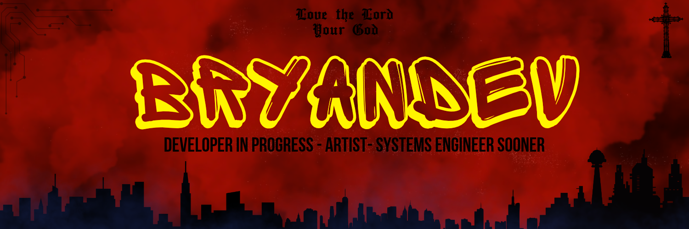

\<!-- BANNER -->

\
   \ \

\<h1 align="center">BRYANDEV\</h1>

\<h3 align="center">Software Engineering Student | Developer in Progress\</h3>

\
   \<i>Building systems, exploring ideas and creating worlds through technology.\</i> \

---

## ABOUT ME

Welcome to my personal development workspace.

I'm a Software Engineering student interested in programming, software development, data analysis and interactive experiences.

I enjoy exploring different technologies, understanding how systems work and combining technical knowledge with creativity.

My goal is to keep learning, building practical projects and developing my skills as a software developer.

---

## TECHNICAL BACKGROUND

**Programming Languages**

\
   \   \   \ \

**Frameworks & Development**

\

&#x20; \
&#x20; \
\

**Databases & Tools**

\
   \   \   \ \

---

## CURRENT LEARNING PATH

I'm interested in expanding my knowledge in:

- **Python:** Strengthening programming skills and exploring data analysis.
- **Rust:** Exploring systems programming and memory-safe development.
- **R:** Learning statistical computing and data analysis.
- **SQL:** Improving query writing, relational data concepts and database fundamentals.

---

## FEATURED PROJECTS

A collection of personal projects, programming exercises and practical applications.

*Projects will be added as they are developed and documented.*

---

## CREATIVE UNIVERSE

Beyond programming, I enjoy digital illustration, worldbuilding and original storytelling.

These are some of the creative universes I'm developing.

### FALLEN ANGEL

*Industrial · Dark Fantasy · Nu Metal*

An urban dark fantasy universe exploring identity, conflict and survival through a gritty visual and narrative style.

### RISE OF HERO

*Science Fiction · Military · Action*

A futuristic universe focused on technological development, warfare and action-driven storytelling.

### LUCY

*Gothic · Supernatural · Symbolism*

A narrative exploration of gothic aesthetics, religious symbolism and supernatural themes.

---

## CURRENT OBJECTIVES

- Building practical software projects.
- Strengthening software engineering fundamentals.
- Exploring data analysis and statistical computing.
- Developing interactive experiences and game prototypes.
- Improving code quality, documentation and project organization.

---

\

&#x20; \<i>"Code is another way to build worlds."\</i>
\

\

&#x20; Thanks for visiting my workspace.
\

